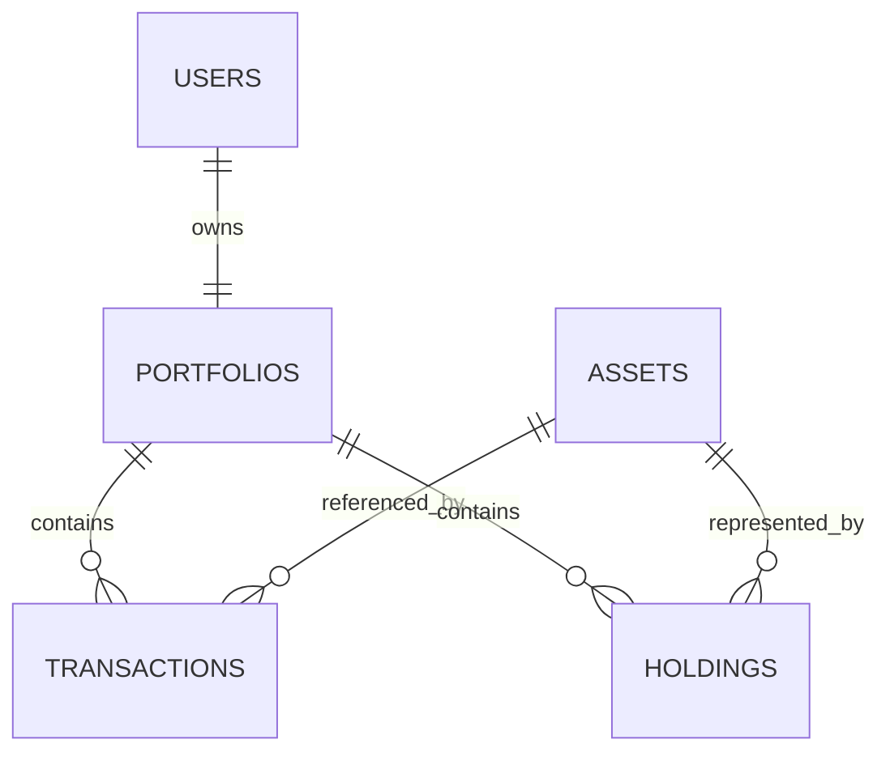

# Wealth Orbit

Multi-user portfolio management platform for mutual funds, stocks, market data, broker integrations, strategies, and analytics.

## Repository layout

```text
wealth-orbit/
├── portfolio-service/
│   ├── backend/
│   └── scripts/
├── frontend/
├── market-data-service/
├── mutual-fund-reference/
├── broker-integrations/
├── strategy-engine/
├── analytics/
├── migrations/
├── docs/
└── tests/
```

## Setup

Portfolio data is stored locally in SQLite. The default is `sqlite+aiosqlite:///./portfolio-service/portfolio.db`; set `PORTFOLIO_SQLITE_URL` to change it.

General mutual-fund, stock, index, and ingestion data belongs in PostgreSQL. Set `DATABASE_URL` to the Supabase session-pooler connection string. The portfolio database keeps only a stable local `asset_id`; there are no cross-database foreign keys.

Install dependencies with `uv sync`, then apply the schema:

```bash
uv run alembic -c migrations/alembic.ini upgrade head
```

Run tests with `pytest`.

### Seed market data (Postgres / Supabase)

Reference CSVs live under `data/seed/` (`indices.csv`, `stocks.csv`, `new_equity_only_updated.csv`). With `DATABASE_URL` set, seed each asset class separately (recommended) or all together:

```bash
# Indexes only (masters + Yahoo OHLC history)
uv run python portfolio-service/scripts/seed/run_seed_indexes.py --data-dir data/seed

# Stocks: masters + OHLC by default (fundamentals are optional / slow)
uv run python portfolio-service/scripts/seed/run_seed_stocks.py --data-dir data/seed --limit 20
uv run python portfolio-service/scripts/seed/run_seed_stocks.py --with-fundamentals --limit 5

# Mutual funds: masters + NAV history (metrics/enrichment/benchmark stay on-demand in UI)
uv run python portfolio-service/scripts/seed/run_seed_funds.py --data-dir data/seed --limit 10

# Or orchestrate all three
uv run python portfolio-service/scripts/seed/run_all_seeds.py --data-dir data/seed
uv run python portfolio-service/scripts/seed/run_all_seeds.py --only stocks --with-fundamentals --limit 3
```

Useful flags: `--dry-run`, `--limit N`, `--price-period 5y`, `--index-period max`, `--skip-masters` / `--skip-history` / `--skip-prices` / `--skip-nav`, and for stocks `--with-fundamentals` (off by default).

Masters-only and price-only wrappers still work:

```bash
uv run python portfolio-service/scripts/load_reference_data.py --data-dir data/seed
uv run python portfolio-service/scripts/sync_yfinance.py --period 5y
```

To import the mutual-fund order-history workbook into the local database:

```bash
python portfolio-service/scripts/import_transactions.py /path/to/Mutual_Funds_Order_History.xlsx
```

The importer processes rows chronologically and preserves duplicate source orders as separate transactions. Use `--mode append` for a newer export; already imported source rows are skipped. Use `--mode update` when the same export has corrections; it rebuilds that source file's transactions and holdings. If the export contains a redemption for units acquired before the report window, it seeds an opening balance transaction so the local holding never becomes negative.

The dashboard shows invested debt and equity totals using the local `assets.investment_class` classification. The current importer classifies short-term, ultra-short-term, liquid, money-market, corporate-bond, and gilt funds as debt; other imported mutual funds are classified as equity and can be corrected later as reference data improves.

Launch the dashboard with:

```bash
uv run streamlit run frontend/streamlit_app.py
```

The dashboard hides soft-deleted users, shows current holdings and full transaction history, and records buys or sells using the same weighted-average cost rules. It intentionally does not calculate market value because live pricing is outside the current scope.

## Schema

`users` have one `portfolio`. A portfolio owns immutable `transactions`; each transaction references a local `asset`. `holdings` is a current aggregate keyed by `(portfolio_id, asset_id)` and can be rebuilt from transactions. Mutual-fund descriptive records live in PostgreSQL and can be synchronized into local asset identity records.



The weighted-average cost service locks the holding row during a transaction. Buys add quantity and cost; sells remove quantity and the proportional remaining cost basis. A zero position removes the holding while retaining all transactions.

Holdings can be reconstructed by replaying transactions per portfolio and asset in transaction-date/order sequence, applying the same weighted-average formulas used by `portfolio-service/backend/services.py`.
