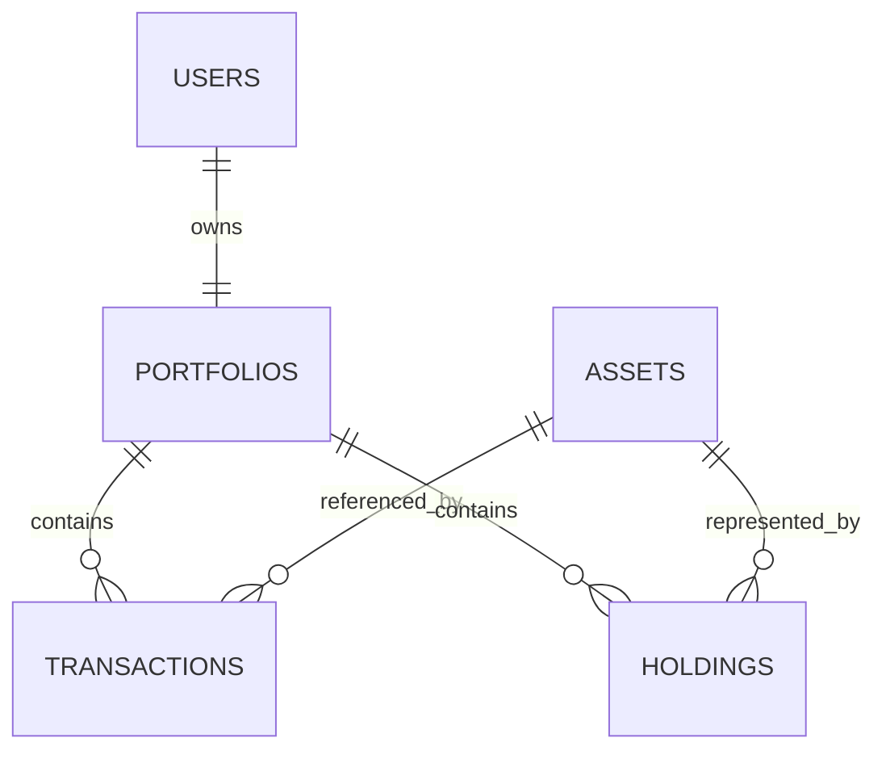

# Wealth Orbit

Multi-user portfolio management platform for mutual funds, stocks, market data, broker integrations, strategies, and analytics.

## Repository layout

```text
wealth-orbit/
├── portfolio-service/
│   ├── backend/
│   └── scripts/
├── frontend/
├── market-data-service/
├── mutual-fund-reference/
├── broker-integrations/
├── strategy-engine/
├── analytics/
├── migrations/
├── docs/
└── tests/
```

## Setup

You need a Postgres database you already have, such as Supabase. From the repo root:

```bash
./scripts/setup.sh
```

On Windows:

```bat
scripts\setup.bat
```

Then open http://127.0.0.1:8000/ui/ and choose **Create an account**. The prompts, seed options, and a later restart are in [docs/setup.md](docs/setup.md).

## Schema

`users` have one `portfolio`. A portfolio owns immutable `transactions`; each transaction references a local `asset`. `holdings` is a current aggregate keyed by `(portfolio_id, asset_id)` and can be rebuilt from transactions. Mutual-fund descriptive records live in PostgreSQL and can be synchronized into local asset identity records.



The weighted-average cost service locks the holding row during a transaction. Buys add quantity and cost; sells remove quantity and the proportional remaining cost basis. A zero position removes the holding while retaining all transactions.

Holdings can be reconstructed by replaying transactions per portfolio and asset in transaction-date/order sequence, applying the same weighted-average formulas used by `portfolio-service/backend/services.py`.
