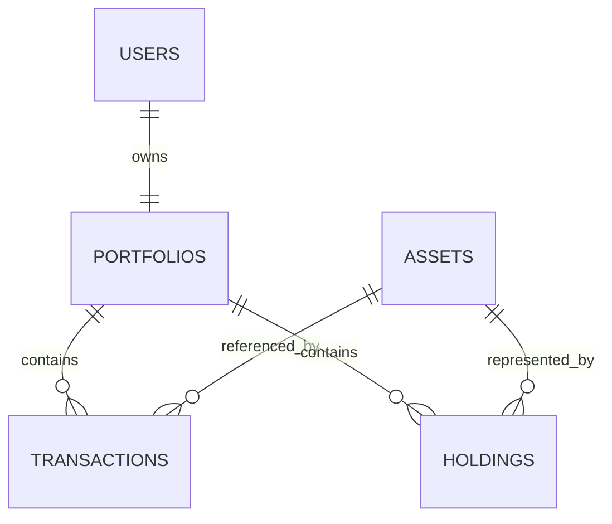

# Wealth Orbit

Multi-user portfolio research for India mutual funds and listed equities: local portfolio ledger, shared market research in Postgres, React UI at `/ui/`, and a FastAPI monolith.

**Naming:** The product UI and API are **Wealth Orbit**. **Nivesh** is the historical PRD / codename in older documents ([`docs/Nivesh_Product_Requirements_and_Roadmap_v1.1.md`](docs/Nivesh_Product_Requirements_and_Roadmap_v1.1.md)).

## License & learning disclaimer

This repository is a **personal learning / portfolio project**, not a commercial product or official Zerodha offering.

Any Zerodha Varsity materials used for local study (PDFs, chapter indexes, RAG extracts, or similar) remain **© Zerodha**. Credit for that educational content belongs entirely to **Zerodha**. Do not redistribute Varsity documents or treat them as part of this project's license. Local copies stay gitignored for offline research only — see [`docs/varsity_docs/README.md`](docs/varsity_docs/README.md).

Wealth Orbit's own code and curated glossary seed definitions are separate from Varsity's copyrighted materials.

## Documentation

| Start here | Purpose |
|------------|---------|
| [docs/README.md](docs/README.md) | Handbook hub (architecture, data, API, releases) |
| [docs/getting-started.md](docs/getting-started.md) | Checklist: Supabase pooler → setup → first account |
| [docs/setup.md](docs/setup.md) | Full installer, seeds, sync, and operations |
| [docs/architecture.md](docs/architecture.md) | Runtime diagram and module boundaries |

## Dual database (by design)

| Store | Env var | Holds |
|-------|---------|--------|
| Supabase Postgres (`market_data` schema) | `DATABASE_URL` | Shared research: masters, OHLC/NAV, fundamentals caps, sync jobs |
| Local SQLite | `PORTFOLIO_SQLITE_URL` | Private ledger: users, portfolios, holdings, transactions |

Market history does not belong in SQLite. See [docs/data/overview.md](docs/data/overview.md).

## Repository layout (shipped)

```text
wealth-orbit/
├── backend_api/              # FastAPI app, routers, static `/ui/` mount
├── frontend-react/           # Primary React SPA (Vite, base `/ui/`)
├── frontend/                 # Legacy Streamlit UI (optional)
├── portfolio-service/
│   ├── backend/              # Domain: portfolio ledger, market_data, screen_plugins
│   └── scripts/              # Seeds, sync CLIs, workbook import
├── screens/                  # Stock screen plugins + registry
├── nivesh_screens/           # Shared helpers for screen authors
├── migrations/               # Alembic → Postgres `market_data`
├── data/seed/                # India master CSVs
├── tests/                    # pytest (API, market data, screens, React unit tests)
├── docs/                     # Handbook, releases, PRD, specs
│
├── market-data-service/      # (empty placeholder)
├── strategy-engine/          # (empty placeholder)
├── broker-integrations/      # (empty placeholder)
├── analytics/                # (empty placeholder)
└── mutual-fund-reference/    # (empty placeholder)
```

Empty top-level folders are aspirational names only — not separate deployables. All runtime code lives in `backend_api`, `portfolio-service`, `frontend-react`, and `screens`.

## Quick start

```bash
./scripts/setup.sh
```

Then open [http://127.0.0.1:8000/ui/](http://127.0.0.1:8000/ui/) and **Create an account**. Details: [docs/getting-started.md](docs/getting-started.md).

## Portfolio model (summary)

`users` own one `portfolio`. Portfolios contain immutable `transactions` tied to local `assets`. `holdings` are the current aggregate per `(portfolio_id, asset_id)` and can be rebuilt from transactions (weighted-average cost). Mutual-fund identity and NAV live in Postgres and sync into asset records where needed.



Deeper data notes: [docs/data/portfolio.md](docs/data/portfolio.md).