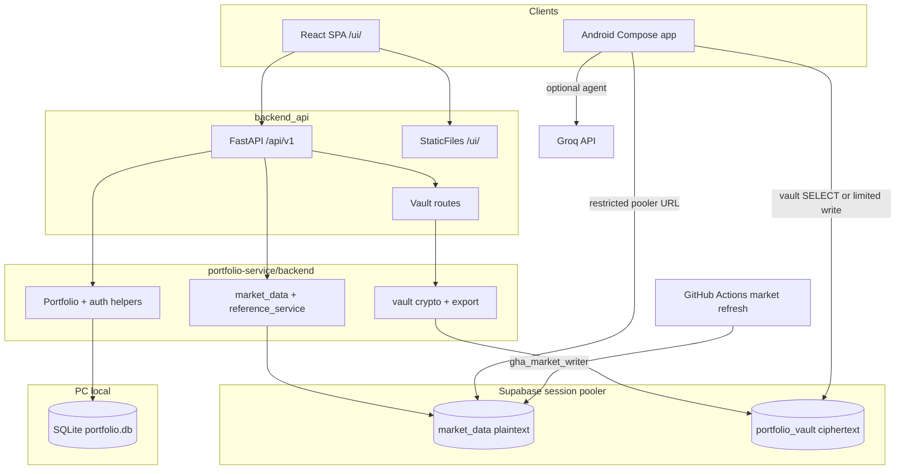

# Architecture (shipped)

How Wealth Orbit runs today on a developer machine. Longer-term modular-monolith / stance-roadmap notes may live in local-only planning docs under `docs/superpowers/` (gitignored).

## Runtime summary

| Piece | Location | Notes |
|-------|----------|--------|
| HTTP API | `backend_api/app/main.py` | FastAPI, OpenAPI at `/docs` |
| UI | `frontend-react/dist` served at `/ui/` | Vite SPA; legacy paths redirect into `/ui` |
| Portfolio domain | `portfolio-service/backend/` | SQLAlchemy models, transaction engine, `reference_service` |
| Market sync | `portfolio-service/backend/market_data/` | Providers, sync jobs, instrument registry |
| Screen plugins | `screens/` + `portfolio-service/backend/screen_plugins/` | Discovery, validation, SQL snapshot |
| Seeds / CLIs | `portfolio-service/scripts/` | Postgres load, Yahoo/Screener/MFAPI paths |
| Legacy UI | `frontend/streamlit_app.py` | Optional Streamlit; not the daily product UI |

Placeholder directories at repo root (`market-data-service/`, `strategy-engine/`, etc.) are **empty** — naming only, not processes.

## Request flow

- **Research reads** (most stock/MF list and detail endpoints) use `DATABASE_URL` and do not require login.
- **Portfolio writes** on PC still use a session cookie backed by SQLite until cutover; encrypted cloud path is `public.portfolio_vault` via vault API / Android.
- **Sync** runs in-process on PC (thread pool + `sync_jobs`); weekday incremental refresh also runs in GitHub Actions (`.github/workflows/market-data-refresh.yml`).
- **Android** never embeds the PC superuser pooler URL; setup stores a restricted role URI + encryption secret.

## Module boundaries (practical)

| Concern | Owns |
|---------|------|
| `backend_api` | Routing, auth cookie, static UI mount, thin orchestration |
| `portfolio-service/backend/services.py` | Holdings math, transaction application |
| `portfolio-service/backend/market_data/` | Ingestion, retention caps, instrument add |
| `portfolio-service/backend/screen_plugins/` | User screen lifecycle |
| `frontend-react` | Pages, React Query to `/api/v1` (incl. Vault settings) |
| `android/` | Kotlin Compose client: setup, vault decrypt, RO market, Groq |
| `screens/stock/` | Operator-authored filter plugins |
| `migrations/` | Alembic revisions targeting Postgres only |
| `.github/workflows/` | Scheduled `market_data` incremental refresh |

## Authentication

Local accounts in SQLite: signup/login set an HTTP-only cookie. There is no email reset flow; see [setup.md](setup.md#forgotten-password).

Multi-client vault ownership is keyed by `VAULT_USER_ID` (same UUID on PC `.env` and Android setup). Email Auth is optional/not required for the pooler path.

## What is not shipped yet

Future milestones (MTM/XIRR, watchlists, stance engine, glossary chat, strategy lab, full SQLite→vault cutover as default) are tracked in local-only `docs/releases/` when present. Until those land in the product, the UI remains **cost-basis portfolio** plus **stored market research** — no buy/sell stance layer in production code.

## Related docs

- [data/overview.md](data/overview.md) — dual database + vault policy
- [design/2026-11-23-multi-client-e2e-portfolio-design.md](design/2026-11-23-multi-client-e2e-portfolio-design.md) — multi-client E2E design
- [design/portfolio-vault-crypto.md](design/portfolio-vault-crypto.md) — ciphertext + JSON contract
- [api/overview.md](api/overview.md) — route groups
- [getting-started.md](getting-started.md) — bootstrap
- [../android/README.md](../android/README.md) — Android build