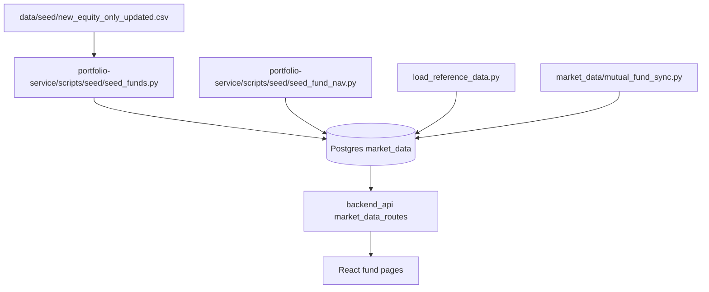

# Mutual fund data lineage (in-repo)

Canonical load path for this repository — not an external `nivesh-server` tree.

## High-level flow

## Steps

1. **Masters** — AMC, category, subcategory, and scheme rows from seed CSVs (`seed_funds.py`, orchestrated by `run_seed_funds.py`).
2. **Reference load** — `portfolio-service/scripts/load_reference_data.py` can bulk-upsert from `data/seed/`.
3. **NAV history** — `seed_fund_nav.py` / sync routes pull NAV by `scheme_code` and date; upserts are source-aware and idempotent on natural keys.
4. **Enrichment** — holdings, managers, benchmark, metrics paths in `mutual_fund_sync.py`, `mutual_fund_analytics.py`, and Kuvera/Groww providers where configured.
5. **API surface** — list, screen, compare, detail, history, and per-dimension sync POSTs under `/api/v1/market-data/mutual-funds/*`.
6. **Portfolio boundary** — user transactions and holdings remain in SQLite; UI never stores NAV series locally.

## Operators

| Task | Entry point |
|------|-------------|
| Guided seed | `./scripts/setup.sh` optional fund prompts |
| Masters + capped NAV | `uv run python portfolio-service/scripts/seed/run_seed_funds.py --data-dir data/seed` |
| On-demand sync | Fund detail **Sync** buttons or POST `/api/v1/market-data/mutual-funds/{scheme_code}/sync/*` |
| Add scheme | UI **Add fund** or POST `/api/v1/market-data/instruments/mutual-funds` |

## Data quality rules

- Missing inputs stay **NULL**; calculated metrics require sufficient NAV history.
- Re-sync uses watermarks / upsert keys so repeated runs do not duplicate schemes or NAV points.
- Sync job failures surface in UI recent jobs and `sync_jobs` rows.

Legacy doc [../mutual-fund-data-lineage.md](../mutual-fund-data-lineage.md) pointed at an old monorepo path — use **this file** instead.