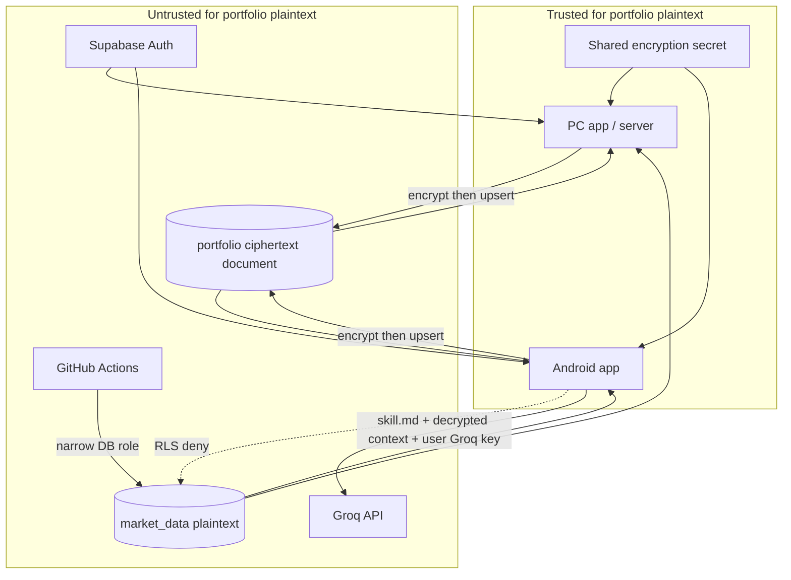

# Multi-client E2E portfolio design

**Status:** Approved for implementation planning  
**Date:** 2026-11-23  
**Branch:** `docs/multi-client-e2e-portfolio-design`  
**Implementation plan:** [2026-11-23-multi-client-e2e-portfolio-plan.md](./2026-11-23-multi-client-e2e-portfolio-plan.md)

## 1. Problem

Wealth Orbit today is a single-machine product: React + FastAPI, portfolio/auth in local SQLite, shared market research in Supabase Postgres. There is no mobile client, no reliable daily market refresh without a running PC, and no way for a phone and PC to share the same portfolio ledger.

We want dual clients (PC + Android) with a cloud source of truth, privacy for holdings against the database host, free-tier-friendly market updates, and an optional on-device agent.

## 2. Goals (v1)

1. PC and Android both read/write the **same** portfolio via a remote store.
2. Portfolio plaintext never exists on Supabase; only ciphertext is stored and returned.
3. Shared market research stays plaintext in Supabase `market_data`.
4. GitHub Actions performs scheduled market data updates.
5. Android is **read-only** for market data; may write **portfolio ciphertext only**.
6. Android can run a Groq-backed agent with a local `skill.md` after decrypting portfolio on device.
7. Lost encryption secret makes old portfolio unrecoverable; vault reset is **PC-only**.
8. Android client is **Kotlin + Jetpack Compose** and stays **lightweight** (no heavy local compute or bulk market sync).
9. Android **minSdk = 24** (Android 7.0 Nougat and newer).

## 3. Non-goals (v1)

- Phone background cron as the platform notification / digest backbone
- Server-side portfolio analytics, digests, or Edge Functions that decrypt holdings
- Append-only encrypted transaction log at the DB layer
- OS keyring for PC secret storage (env file only)
- Proxied / server-held Groq API keys
- PocketServer as source of truth
- Always-on free PaaS hosting of FastAPI + SQLite
- iOS client
- Migrating every existing FastAPI feature onto mobile in one release
- Heavy on-device ML, large offline market mirrors, or bulk OHLC sync on the phone

## 4. Trust boundaries

| Party | May see portfolio plaintext? | Role |
|-------|------------------------------|------|
| Supabase | **No** | Auth identity; store/return ciphertext; plaintext market data |
| PC client / PC server | **Yes** | Encrypt/decrypt; admin vault reset; full UI |
| Android app | **Yes** | Encrypt/decrypt; UI; Groq agent |
| GitHub Actions | **No** | Incremental `market_data` writes only |
| Groq | **Yes, if prompted** | Receives whatever context the Android agent sends |

**Product honesty:** Encryption protects data at rest in Supabase. It does **not** protect holdings once the user asks the Groq agent about their portfolio.

## 5. Architecture

### Components

| Component | Responsibility |
|-----------|----------------|
| Supabase Auth | Email/password identity; JWT for RLS (`auth.uid()`) |
| `market_data` schema | Existing shared research (masters, OHLC/NAV, etc.) |
| Portfolio vault table | One encrypted document per user |
| PC Wealth Orbit | Decrypt/encrypt with env secret; portfolio + research UI; vault reset |
| Android app | **Kotlin + Jetpack Compose** lightweight client; same crypto; research read; portfolio write; local agent |
| GitHub Actions | Scheduled market refresh using market-scoped credentials |
| Groq | Optional Q&A; user-supplied API key on device |

PocketServer remains out of the critical path (optional offline cache later).

### 5.1 Android stack and lightness (locked)

- **Language / UI:** Kotlin + Jetpack Compose.
- **Minimum OS:** **Android 7.0+** (`minSdk = 24`). Aligns with broad device coverage (including older phones) and with PocketServer’s Android 7+ target; use AndroidX / desugaring as needed so Compose and crypto APIs stay compatible.
- **Goal:** a **lightweight** client — small APK surface, low RAM/CPU when idle, no background bulk sync.
- **Do on device:** decrypt single portfolio document; show focused research views (e.g. indexes, watchlist, latest metrics); simple derived numbers; Groq calls over the network.
- **Do not on device:** full-universe OHLC history sync; large local market DB; on-device LLM; continuous WorkManager polling; embedding the PC FastAPI stack.
- **Data habit:** fetch narrow queries from Supabase; cache only what the current screens need; prefer network-on-open over always-on sync.
- **Agent:** one-shot / chat requests to Groq over HTTPS; no local model weights. Groq’s official SDKs are Python/TypeScript, but the API is OpenAI-compatible REST ([API reference](https://console.groq.com/docs/api-reference), [overview](https://console.groq.com/docs/overview)) — call `POST https://api.groq.com/openai/v1/chat/completions` from Kotlin (OkHttp/Ktor). Flutter or React Native is **not** required for Groq.
- **APK posture:** prefer official small libraries (Supabase Kotlin client or thin HTTP + JWT, Android Keystore, cryptography). Avoid shipping unused Google/ML SDKs. Verify dependency `minSdk` does not force above 24.

## 6. Data model

### 6.1 Portfolio ciphertext document

One row per user:

| Column | Type | Notes |
|--------|------|-------|
| `user_id` | UUID (FK / auth uid) | RLS owner |
| `vault_generation` | int | Bumped on PC vault reset |
| `version` | int | Monotonic; conflict detection |
| `ciphertext` | bytea / text | AES-256-GCM payload (nonce + tag + ciphertext as documented) |
| `updated_at` | timestamptz | Audit |

**Plaintext (before encrypt):** single JSON snapshot of the portfolio (holdings and transactions as needed for v1 parity with current ledger semantics). Exact JSON schema is defined in the implementation plan and shared by PC and Android.

**Conflict rule:** read → merge locally → encrypt → write with `version = previous + 1`. Reject or retry if remote `version` changed (last successful writer wins after retry).

### 6.2 Market data

Unchanged intent: plaintext Postgres `market_data` as today. Android and PC **SELECT** only from clients. Writers: GitHub Actions (and optionally PC tools with elevated role during migration)—never the Android app.

### 6.3 Auth vs encryption secret

| Secret | Purpose | Storage |
|--------|---------|---------|
| Supabase email/password | Identity / RLS | Supabase Auth |
| `PORTFOLIO_ENCRYPTION_SECRET` | Encrypt/decrypt portfolio document | PC: `.env` (gitignored). Android: Keystore-backed secure storage |
| Groq API key | Agent calls | Android app settings only (user-supplied) |

These three must never be conflated.

## 7. Cryptography (v1)

- Algorithm: **AES-256-GCM**
- Key material: shared high-entropy secret (API-key style), identical on PC and Android
- Interoperability: documented binary layout (nonce length, AAD if any, encoding) so PC (Python/TS) and Android produce compatible ciphertext
- Supabase never receives the secret
- GitHub Actions never receives the secret

## 8. Key lifecycle

### 8.1 Initial setup

1. User creates Supabase Auth account (email/password).
2. User (or PC setup) generates `PORTFOLIO_ENCRYPTION_SECRET` into PC `.env`.
3. User pastes the same secret into Android secure settings.
4. Optional: user adds Groq API key and local `skill.md` on Android.

### 8.2 Lost secret

- Existing ciphertext is permanently unreadable.
- No server recovery path.

### 8.3 Vault reset (PC only)

1. Authenticated user on PC chooses **Reset portfolio vault**.
2. Strong confirmation (re-auth / typed phrase).
3. Delete or replace portfolio row(s); increment `vault_generation`.
4. Set new `PORTFOLIO_ENCRYPTION_SECRET` in PC `.env`.
5. User re-enters or re-imports portfolio under the new secret.
6. User pastes new secret on Android (Android has **no** reset action).

## 9. Android write policy (mandatory)

| Capability | Allowed |
|------------|---------|
| Read `market_data` | Yes |
| Write `market_data` / enqueue full sync | **No** |
| Read own portfolio ciphertext | Yes |
| Write own portfolio ciphertext | Yes |
| Vault reset | **No** (PC only) |
| Service role / market writer credentials | **Never** |

Enforce with RLS/grants and by omitting write APIs from the Android client—not UI alone.

## 10. GitHub Actions market updates

- Workflow `on.schedule` (and `workflow_dispatch`) runs incremental stock/index/NAV-style updates into `market_data`.
- Credentials in GitHub Secrets: market-scoped DB role only (no portfolio table privileges, no encryption secret, no Groq key).
- Prefer off-peak cron minutes; treat schedule timing as best-effort.
- Respect Supabase Free quotas (storage, egress) with incremental jobs, not full-history reloads every run.
- Optional later: market-only notifications (“index moved”); not portfolio digests.

## 11. Groq agent (Android)

1. Load Android-local `skill.md` (not synced in the encrypted cloud document).
2. Fetch market rows + portfolio ciphertext; decrypt with shared secret.
3. Build grounded prompt; call Groq with **user-supplied** API key.
4. Agent is read-mostly: no silent portfolio mutations; no market writes.
5. UX must disclose that portfolio context is sent to Groq.
6. Align with Wealth Orbit’s no-investment-advice posture where applicable.

## 12. Notifications (v1 stance)

- Do **not** use phone cron as scheduler of record.
- Portfolio-aware digests require local decrypt after unlock (or are deferred).
- Market-only alerts may come from CI later.
- Local/OS notifications after unlock are acceptable enhancements.

## 13. Migration from today

Current state: portfolio and local auth in SQLite; market data already on Supabase.

v1 migration outline (detail in implementation plan):

1. Add Supabase Auth and portfolio vault table + RLS.
2. Define shared plaintext JSON snapshot schema mapping from existing SQLite models.
3. PC path: export/encrypt/upload existing ledger; dual-run or cutover from SQLite.
4. Point PC UI at decrypt-render-encrypt cycle for portfolio.
5. Ship Android client for research read + portfolio document sync + agent.
6. Add GHA market refresh; retire reliance on “PC must be on” for daily market updates.
7. PC-only vault reset; document lost-key behavior.

## 14. Free-tier notes

- Supabase Free: 500 MB, inactivity pause after ~1 week, 2 active projects—keep market history trimmed.
- GitHub Actions: suitable free scheduler for market jobs.
- Free PaaS web services (Render/Railway sleep + ephemeral disk) are **not** used to host SQLite portfolio.

## 15. Success criteria

- [ ] Same encrypted portfolio document readable on PC and Android after configuring the shared secret
- [ ] Supabase dashboard / SQL cannot reveal holdings plaintext
- [ ] Android cannot write market tables under normal user JWT
- [ ] GHA updates market data without portfolio credentials
- [ ] Lost secret → unreadable vault; PC reset creates empty vault + new secret
- [ ] Android agent answers using local skill.md + decrypted context via user Groq key
- [ ] Android app stays lightweight: no bulk market sync or on-device LLM; narrow fetches only
- [ ] App installs and runs on Android 7.0 (API 24) and newer
- [ ] Design and implementation docs stay consistent with [architecture.md](../architecture.md) and [data/overview.md](../data/overview.md) until those are updated in the same initiative

## 16. Open for implementation plan (not undecided product)

These are engineering choices to specify in `docs/superpowers/plans/` or follow-on plan tasks—not open product debates:

- Exact ciphertext binary framing and AAD contents
- Exact portfolio JSON schema fields
- ~~Android stack~~ — **locked: Kotlin + Jetpack Compose, lightweight client**
- Whether PC encrypt/decrypt lives in FastAPI process or a small shared library called from the API
- Cutover strategy details (dual-write period vs hard cut)
- RLS policy SQL and market-writer DB role DDL
