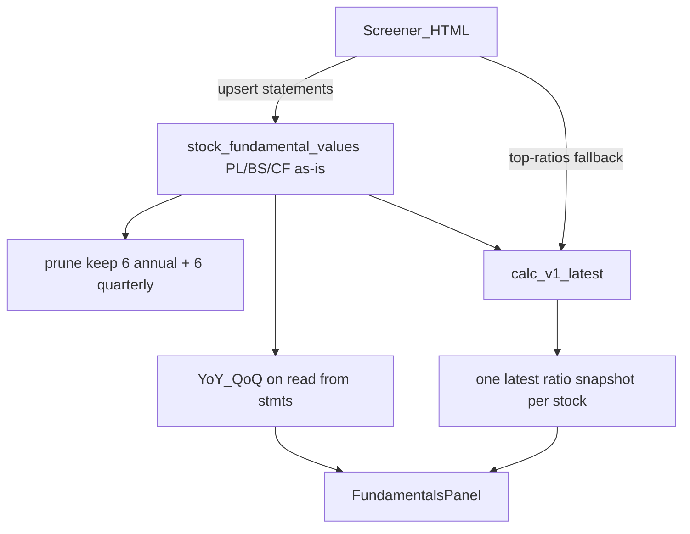

# Release 1.9 — Deeper fundamentals (storage-tight)

**Branch:** `release/1.9-deeper-fundamentals`  
**Frozen outline:** [docs/releases/1.9-deeper-fundamentals.md](../../releases/1.9-deeper-fundamentals.md)  
**Cursor plan:** `.cursor/plans/release_1.9_deeper_fundamentals_c5c13aaf.plan.md`

## Spec / process

- Outline: [docs/releases/1.9-deeper-fundamentals.md](docs/releases/1.9-deeper-fundamentals.md)
- Process: `main` (post-1.8) → `release/1.9-deeper-fundamentals` → plan in `docs/superpowers/plans/` → draft PR → implement
- Do not edit 1.2–1.8 plans; do not reopen 1.2 honesty rules

## Outcome / exit

Richer Fundamentals UI (ratio groups + YoY/QoQ trends) without bloating storage: **statements capped**, **ratios latest-only**.

## Locked product decisions

| Decision | Choice |
|----------|--------|
| Statement fetch/store | Screener PL/BS/CF **as-is** (no modifying scraped values) |
| Statement retention | **6 annual** + **6 quarterly** distinct `period_end_date`s per `(stock_id, reporting_basis)` (raise from today’s 5 annual) |
| Ratio history | **Do not store** multi-period `RATIOS` rows in `stock_fundamental_values` |
| Ratio persistence | **One latest snapshot per stock** — UPSERT; delete any older ratio-snapshot dates (same idea as [`sync_technical_indicators`](portfolio-service/backend/market_data/sync.py) / `sync_daily_metrics`) |
| Ratio source | Compute from stored statements **first**; Screener `#top-ratios` **fallback** for missing inputs; **computed wins** |
| Trends (YoY/QoQ) | **Compute on read** from the capped statement history — never persist a growth time series |
| Duplicate data | No second copy of statement lines; no parallel historical ratio warehouse; prefer extending the existing **latest** metrics snapshot rather than a new history table |
| Combine with technicals | Latest fundamental ratios live alongside the existing **latest-only** analytics pattern (daily_metrics / technicals)—do not invent a third historical store |
| UI | Tables + YoY/QoQ; no charts; no new Screener statement line scraping in 1.9 |
| 1.7 screens | Snapshot math **stays separate** |

## Storage model (critical)

### Layer A — Statements (history, small)

- Table: existing `market_data.stock_fundamental_values` for **PL / BS / CF only**
- Write path: current sync UPSERT; **do not alter metric values** after fetch
- Cap: update [`fundamentals_retention.py`](portfolio-service/backend/market_data/fundamentals_retention.py) `ANNUAL_KEEP = 6`, keep `QUARTERLY_KEEP = 6`
- Dual basis unchanged (SA and consol each get their own 6+6)

### Layer B — Ratios (latest only, one snapshot per stock)

- **Not** written as many `statement_type='RATIOS'` period rows
- Persist a **single current snapshot** per `stock_id` (columns for profitability / leverage / liquidity / efficiency / key growth rates as-of latest period)
- **Locked implementation choice:** extend / reuse [`stock_daily_metrics`](portfolio-service/backend/market_data/sync.py) **latest-row** pattern (insert/upsert for “today” or statement as-of date, **DELETE older** rows for that stock)—add only the fundamental-ratio fields still missing, with `calculation_method` / source flags so Yahoo daily fields and statement-derived fields do not silently fight without rules
- Overlap fields (e.g. ROE/ROCE already on daily_metrics from Yahoo): **Fundamentals tab reads statement-derived snapshot fields**; if both would collide in the same columns, prefer a clear `source`/`method` on the snapshot and document that statement recompute updates those fields on fundamentals sync (Overview can keep showing Yahoo until a later honesty pass—**locked for 1.9:** statement recompute writes dedicated fundamental ratio columns or a JSON `fundamental_ratios` bag on the latest daily_metrics row to **avoid duplicating** a whole new table and avoid clobbering unrelated Yahoo valuation fields unnecessarily)

Practical shape (pick in impl, one row per stock):

- Preferred: **one latest `stock_daily_metrics` row** holding a structured `fundamental_ratios` JSONB (or narrow new columns) + existing Yahoo valuation fields; delete older metric_dates  
- Alternative only if JSONB awkward: tiny `stock_latest_fundamental_ratios (stock_id PK, …, as_of, method, updated_at)` — still **one row**, no history  

### Layer C — Trends (ephemeral)

- API builds YoY (annual) / QoQ (quarterly) % from Layer A period columns at read time
- Nothing stored for “REVENUE_GROWTH for FY20, FY21, …”

## Ratio engine behavior

After statement sync + prune:

1. Take **latest** period per selected basis (default CONSOLIDATED for snapshot; SA available when UI asks—**latest snapshot stores the active basis used at sync**, typically consol; SA latest can be computed on read or stored only if we keep one bag with both—**locked:** snapshot stores **consol latest** ratios; SA ratios computed on read when basis=STANDALONE to avoid two stored histories).
2. Compute `calc_v1` metrics; null where inputs missing.
3. Fill gaps from mapped Screener `#top-ratios` (already parsed, currently discarded).
4. UPSERT latest snapshot; delete older snapshot dates for that stock.
5. Re-run is idempotent (same stock → still one row).

### Groups (UI / summary)

| Group | Metrics |
|-------|---------|
| profitability | ROE, ROCE, PAT_MARGIN, OPERATING_MARGIN |
| growth | latest YoY/QoQ revenue & EPS growth (from statements on read; optionally cache latest growth rates on snapshot only) |
| leverage | DEBT_TO_EQUITY, INTEREST_COVERAGE |
| liquidity | CURRENT_RATIO, QUICK_RATIO (compute or Screener fallback; else empty) |
| efficiency | ASSET_TURNOVER, ROA |

## UI

[`FundamentalsPanel.tsx`](frontend-react/src/pages/stocks/panels/FundamentalsPanel.tsx):

- Statement grids: up to 6 annual or 6 quarterly columns from stored lines (as-is)
- Ratio section: **latest values** from snapshot + **trend table** whose period columns are derived on read from statements (not from stored ratio history)
- SA ≠ consol labeling; as-of + definition/method notes
- Missing → blank

## File map

| Area | Touch |
|------|--------|
| Retention | [`fundamentals_retention.py`](portfolio-service/backend/market_data/fundamentals_retention.py) → 6+6 |
| Engine | new `fundamental_ratios.py` (compute + fallback map) |
| Sync | [`sync_stock_fundamentals`](portfolio-service/backend/reference_service.py) — statements as-is; then latest snapshot write; wire top-ratios |
| Latest persist | mirror delete-older pattern in [`sync.py`](portfolio-service/backend/market_data/sync.py) daily_metrics/technicals |
| API / UI | summary + FundamentalsPanel trends on read |
| Tests | prune 6+6; assert no multi-period RATIOS accumulation; latest snapshot idempotent |

## Non-goals

- Storing years of ratio rows  
- Modifying Screener statement numbers  
- Unifying 1.7 screen math  
- Charts, peers marketplace, estimates, advice  
- Expanding Screener line coverage  

## Done when

- DB holds ≤6 annual and ≤6 quarterly statement period-ends per basis; values match Screener fetch  
- At most **one** latest fundamental-ratio snapshot per stock after sync/recompute  
- UI shows richer groups + YoY/QoQ from statements without historical ratio bloat  
- Exit smoke: one symbol, panels match stored statements + latest ratios
