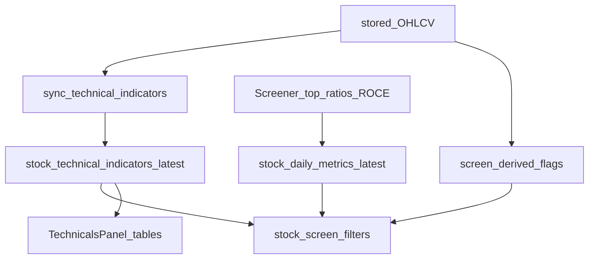

# Release 1.10 — Deeper technicals (screener-handy snapshot)

**Branch:** `release/1.10-deeper-technicals`  
**Frozen outline:** [docs/releases/1.10-deeper-technicals.md](../../releases/1.10-deeper-technicals.md)  
**Cursor plan:** `.cursor/plans/release_1.10_deeper_technicals_09dd48cc.plan.md`

## Spec / process

- Outline: [docs/releases/1.10-deeper-technicals.md](docs/releases/1.10-deeper-technicals.md)
- Base: `main` after 1.9 merges → `release/1.10-deeper-technicals`
- Do not edit 1.2–1.9 plans; do not build chart overlays (1.14) or strategy signals (1.15)

## Product framing

1.10 is not “more chart drawings.” It is the **latest research snapshot a stock screener needs** to filter names:

- **Price/volume technicals** from stored OHLCV (tables + filter columns)
- **Key Screener.in `#ratios`** (e.g. [AFCONS consolidated ratios](https://www.screener.in/company/AFCONS/consolidated/#ratios)) — especially **ROCE** — on the same latest snapshot used for screening

ROCE is a **fundamental** ratio, but traders use it next to technicals when screening. Store it on the **latest** metrics/snapshot (not a new history table). Aligns with “don’t store loads of data.”

## What already exists (do not rebuild)

- Technicals tab + `sync_technical_indicators` + latest-only `stock_technical_indicators` (SMA20, EMA20, RSI14, MACD, BB, ATR)
- Screener `#top-ratios` parse + label map including **ROCE** in `PROVIDER_METRIC_LABELS` (`portfolio-service/backend/market_data/daily_metrics.py`) — often not fully driving daily_metrics/screen fill today
- Screen snapshot already joins `roce` / `sma_200` in `stock_screen.py` when present

## Locked decisions

| Decision | Choice |
|----------|--------|
| **Technical storage (hard rule)** | **Only the latest data.** For each stock, **always update the same rows** — never insert a new historical day of indicators. Re-sync overwrites values + `as_of`/`trading_date`; row count per stock must not grow with calendar time. |
| Ratio / ROCE storage | Same rule on `stock_daily_metrics`: **one latest row per stock** (UPSERT + delete any older `metric_date`) |
| OHLCV technicals | Expand `DEFAULT_INDICATORS` / derived screen flags for trader filters |
| Screener `#ratios` | Persist mapped fields (at least **ROCE**, plus ROE/PE/PB/Div/Book/Mcap when present) into that **single** latest metrics row; prefer Screener when Yahoo missing; document source |
| Sync failure UX | **Empty + error** for screening truth — no silent ephemeral “fake stored” values |
| Versioning | Persist `parameters` + **calculation_version** (e.g. `tech_v1`) on the current snapshot / job result |
| UI | Numbers/tables + “research metrics, not advice”; document overlays OOS |
| Out of scope | Historical technical series; interactive overlays; live trading; patterns (1.14) |

## Storage contract (non-negotiable)

```text
Per stock_id:
  stock_technical_indicators  → fixed set of indicator keys (code/period/component/params)
                                UPDATE in place on every sync; as_of date is a column, not a new partition
  stock_daily_metrics         → exactly one current row (ROCE etc.); overwrite on sync
Forbidden:
  Keeping RSI/SMA/MACD for day D-1, D-2, … after a newer sync
  Growing technical row counts as OHLC history lengthens
```

**Implementation note:** Today writers often UPSERT by `(stock_id, trading_date, …)` then `DELETE` other dates. 1.10 must **preserve that guarantee** and add a test: after two syncs on different OHLC “as of” days, each stock still has **only one** technical snapshot (same logical rows updated, not an accumulating history). If the PK still includes `trading_date`, either (a) keep delete-other-dates airtight, or (b) migrate toward stock-scoped keys with overwritten `as_of` — prefer whichever keeps “one snapshot per stock” impossible to violate.

## Trader-oriented catalog (what to obtain/store)

Think like a discretionary / systematic India equity screener: **trend + momentum + volatility + distance-from-extremes + quality (ROCE)**.

### A. Price trend (from OHLCV → latest technicals + derived flags)

| Item | Why screeners use it | Store |
|------|----------------------|--------|
| SMA 50, SMA 200 | Intermediate/long trend; “above 200 DMA” filters | Indicator rows + values |
| EMA 20 / 50 | Faster trend / pullback context | Indicator rows |
| Price vs SMA50 / SMA200 | Classic “in uptrend” boolean filters | Derived on snapshot: `price_above_sma_50`, `price_above_sma_200`, optional `% distance` |
| Golden/death cross hint | SMA50 vs SMA200 | Optional derived flag `sma50_above_sma200` |

*(SMA20/EMA20 already MVP — keep.)*

### B. Momentum

| Item | Why | Store |
|------|-----|--------|
| RSI(14) | Overbought/oversold bands (e.g. RSI &lt; 30 / &gt; 70) | Already |
| MACD line / signal / hist | Momentum turn / histogram &gt; 0 filters | Already |
| Stochastic %K/%D (14,3) | Short-term stretch vs range | **Add family** |

### C. Volatility / risk

| Item | Why | Store |
|------|-----|--------|
| ATR(14) | Stop distance / “too quiet / too wild” filters | Already |
| Bollinger upper/mid/lower (+ optional %B) | Squeeze / mean-reversion screens | Already (add %B derived if cheap) |

### D. Volume / participation (high value for screeners)

| Item | Why | Store |
|------|-----|--------|
| Volume vs 20d avg | Breakout confirmation / dead names | Derived: `rel_volume_20` on latest snapshot |
| (Optional later) OBV direction | Accumulation — defer if volume avg ships first | Out of 1.10 unless free |

### E. Range position (almost always on trader screens)

| Item | Why | Store |
|------|-----|--------|
| Distance to 52w high / low % | “Near highs” vs “deep value / broken” | Derived from stored OHLC highs/lows on latest snapshot (`pct_from_52w_high`, `pct_from_52w_low`) |

### F. Screener.in `#ratios` (quality — your AFCONS example)

From consolidated (and/or standalone when synced) `#ratios` panel:

| Field | Store on latest daily_metrics | Notes |
|-------|------------------------------|--------|
| **ROCE** | **Required for 1.10** | Map existing `"ROCE"` label; units as Screener reports → normalize consistently with current `roce` column |
| ROE | Fill if missing | Already labeled |
| Stock P/E, P/B, Div yield, Book, Market Cap | Fill gaps vs Yahoo | Existing `PROVIDER_METRIC_LABELS` |

**Do not** scrape/store ratios history — write into the **same** latest metrics row for that stock only.

Wire: fundamentals (or dedicated ratios) sync already parses `_ratios(soup)` — **stop discarding**; call `provider_metrics_from_ratios` and merge into latest `stock_daily_metrics` (Screener fills nulls / agreed prefer rules). Example URL shape: `/company/{slug-or-symbol}/consolidated/#ratios`.

### Explicitly not in 1.10 catalog

- Multi-year indicator history  
- Ichimoku / Supertrend / custom plot studies  
- Intraday VWAP (no intraday bars)  
- Peer relative strength vs Nifty (needs index series join — follow-up)  
- Pattern recognition (1.14)

## Architecture



## Implementation slices

1. Branch + plan PR from `main` (post-1.9)  
2. **ROCE / `#ratios` → latest daily_metrics** — persist mapped Screener ratios; tests with fixture HTML (AFCONS-like `#ratios`)  
3. **Expand technical families** — SMA50/200, EMA50, Stochastic; `calculation_version`; job logs params/version  
4. **Derived screen fields** — above SMA50/200, rel volume 20, 52w distance % (compute at snapshot build or sync; latest only)  
5. **Honesty** — remove silent ephemeral technicals on read for screen/API; empty + sync error; research disclaimer + overlays OOS note in UI/docs  
6. **Screen + UI** — expose new columns to stock screen plugins/filters; Technicals table shows new families  
7. Tests + exit: sync one symbol → ROCE stored; SMA200/RSI/etc filterable; no duplicate latest rows  

## File map

| Area | Touch |
|------|--------|
| Indicators list | `sync.py` `DEFAULT_INDICATORS` + `backend_api/app/technical_indicators.py` |
| Screener ratios | `screener.py` + `daily_metrics.provider_metrics_from_ratios` + fundamentals/daily sync merge |
| Screen snapshot | `stock_screen.py` allowlist + joins |
| UI | `TechnicalsPanel.tsx` |
| Schema | Add `calculation_version` if missing (migration); keep latest-only PK/trim |
| Docs | `screens/README` / setup: screening fields + ROCE source |

## Done when

- **ROCE** (and mapped `#ratios`) on the **single** latest metrics row per stock  
- Additional technical families + derived flags available for screens  
- Re-sync on a newer bar **updates the same technical rows**; test proves **no historical technical accumulation**  
- Technicals UI tables + research-not-advice; empty history honest  
- Exit: deeper families as numbers/tables from stored OHLCV (+ screening ratios), latest-only
